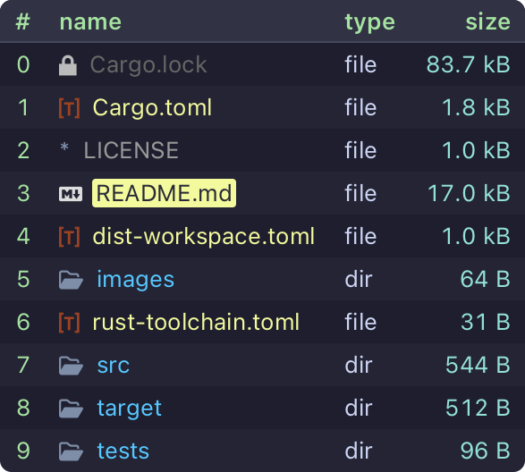
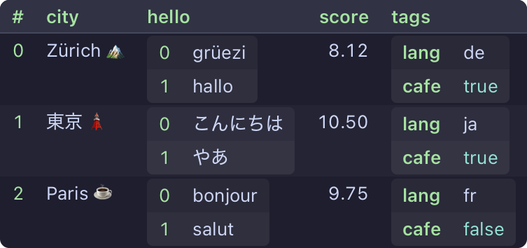
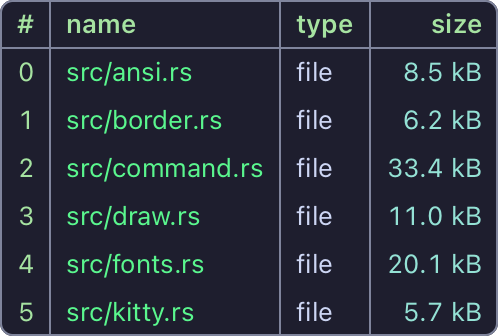
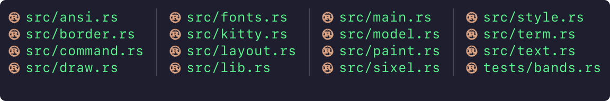

# nu_plugin_render

`table` lines columns up in characters. `render` lines them up in pixels.



`render` is a Nushell plugin, still a prototype. It draws a table as an image
and shows it in the terminal with the kitty graphics protocol or sixel.
Columns line up exactly, emoji and CJK keep their width, and nested lists and
records become nested cards. A string draws as terminal text in its own ANSI
colors, so `grid` output keeps its layout. When the terminal can show neither
kind of image, `render` prints what `table` prints.

```nu
ls | select name type size | render --icons  # the picture above
open data.json | render -e                   # nested lists and records as nested cards
ls | grid -c -i name | render                # text that lines itself up stays lined up
ls | render --png | save ls.png              # the picture, without a terminal
ls | render --copy                           # the picture, on the clipboard
```

## Examples

With `-e`, nested lists and records become cards inside their cells. Emoji
and CJK don't throw the columns off, and floats line up on the decimal point.

```nu
[
  {city: 'Zürich 🏔', hello: [grüezi hallo], score: 8.125, tags: {lang: de, cafe: true}}
  {city: '東京 🗼', hello: [こんにちは やあ], score: 10.5, tags: {lang: ja, cafe: true}}
  {city: 'Paris ☕', hello: [bonjour salut], score: 9.75, tags: {lang: fr, cafe: false}}
] | render -e
```



`--theme` draws the lines of a `table` theme instead of the card:

```nu
ls src | select name type size | first 6 | render -t rounded
```



A string, such as `grid` output, draws as terminal text in a monospace font,
Nerd Font icons included:

```nu
ls src tests | grid -c -i name | render
```



Every picture in this README is `render --png -w 90` output.

## Install

`render` is built against `nu-plugin` 0.117.0, so it loads in Nushell
0.117.x.

Each [release](https://github.com/fdncred/nu_plugin_render/releases) has
binaries for macOS, Linux and Windows, on x86_64 and ARM64.
[cargo-binstall](https://github.com/cargo-bins/cargo-binstall) downloads the
one for your system into `~/.cargo/bin`:

```nu
cargo binstall nu_plugin_render
plugin add ~/.cargo/bin/nu_plugin_render    # nu_plugin_render.exe on Windows
plugin use render
```

On any other system, binstall builds from source, as `cargo install
nu_plugin_render` does. Nobody has run the Linux or Windows binaries yet.

To try a checkout without installing it:

```nu
cargo build --release
nu --plugins '[target/release/nu_plugin_render]'
```

## Flags

| Flag | What it does |
| --- | --- |
| `--png` | Return the drawing as PNG bytes, cut to the card, instead of showing it. `render` paints and encodes it one band at a time, so a tall table needs no more memory than one band. |
| `--copy` | Copy the drawing to the clipboard as an image, cut to the card, instead of showing it. With `--png` as well, it also returns the PNG. |
| `--mono` | Draw a table in a monospace font instead of a sans-serif one. Strings always use monospace. |
| `--width`, `-w` | The widest the drawing may be, in terminal columns. Defaults to the terminal's width, or 160 with `--png` or `--copy`. |
| `--budget` | Draw at most this many million pixels. A table stops at a whole row and a string at a whole line, and a note such as `… 1,941 more rows` ends the drawing. Without it, `render` draws everything. |

These work as they do in `table`:

| Flag | What it does |
| --- | --- |
| `--expand`, `-e` | Draw nested lists and records as nested cards, however deep. Without it they show as summaries such as `[table 3 rows]`. |
| `--expand-deep`, `-d` | How many levels `--expand` nests. Deeper ones show their summary. |
| `--flatten` | With `--expand`, a list of plain values in a table's row shows on one line. A record's values don't flatten. |
| `--flatten-separator` | What `--flatten` joins with. Defaults to a space. |
| `--collapse`, `-c` | Merge nested tables into their cells. Each one fills its cell and shares its lines, with lines between all rows. Every level nests, and the index shows only with `--index`. On the card, the merged cells get quiet lines. |
| `--index`, `-i` | `false` hides the `#` column, `true` shows it, and a number starts it there. Nested tables count from 0. |
| `--abbreviated`, `-a` | Show only this many rows at the top and bottom, with a `...` row between. Defaults to `$env.config.table.abbreviated_row_count`. |
| `--icons`, `-o` | Put a file icon from devicons before each path that `LS_COLORS` styles, as `table --icons` does. |
| `--theme`, `-t` | Draw the lines of a `table` theme, such as `rounded`, `heavy` or `psql`, instead of the card. `card`, the default, has no lines. |
| `--list`, `-l` | List the themes `--theme` takes, `card` first. |

When `render` falls back to `table`, it passes these flags and `--width`
along.

To see why `render` fell back, or how long each phase took, set
`NU_PLUGIN_RENDER_DEBUG=1` in the environment Nushell starts with. `render`
writes the reason and the timings to stderr.

## What it draws

A table gets:

- A header band, and the `#` index column as
  `$env.config.table.index_mode` says.
- Zebra-striped rows on a rounded card.
- Colors from `color_config`, closures included.
- `LS_COLORS` colors on path columns, such as the `name` column of `ls`,
  following `table`'s rules:
  - nushell's own defaults when `$env.LS_COLORS` isn't set
  - no colors when `$env.config.ls.use_ls_colors` is off
  - the default text color for a path with no style
  - a background, such as the one on `README.md`, drawn as a highlight
- The colors, bold and backgrounds of any ANSI escapes inside a cell.
- Numbers aligned right, in tabular digits. A column of floats lines up on
  the decimal point, at `float_precision`.
- With `--expand`, nested lists and records as smaller cards.
- A footer that repeats the header below the rows, as `footer_mode` says.
  With `footer_inheritance`, nested rows count toward it.
- With `show_empty`, a dimmed `empty list` or `empty record` for an empty
  value. Without it, nothing.
- `$env.config.table.missing_value_symbol`, centered in the `empty` color,
  where a record in a list lacks one of the list's columns.
- Multi-line strings, with their lines kept.
- A dark card, or a light one when the terminal reports a light background
  through OSC 11.

When a table is wider than the screen, `render` fits it in these steps:

1. The widest text columns get narrower. Their text wraps, between words
   when `wrapping_try_keep_words` is on. With `trim.methodology:
   truncating`, `render` cuts the text short instead and ends it with
   `truncating_suffix`. Number columns shrink only when they alone are wider
   than the screen.
2. Each column's nested tables get the room the other columns leave.
3. A nested table shows its summary, such as `{record 39 fields}`, when it
   would get less than about two dozen characters, or when fitting it would
   cut any column but its last, such as a record's keys.
4. If the table is still too wide, the widest nested tables collapse one at
   a time until it fits.

With `--theme`, `render` draws each theme's lines the way `table` draws them
in characters:

- the frame, and the lines between columns, under the header and between
  rows
- rounded, square or heavy corners
- thin, heavy, double or dotted strokes, and hearts for `with_love`
- the gaps between `restructured`'s columns

In the terminal there's no card behind the lines, so the text sits on the
terminal's own background. `--png` and `--copy` put the card's color behind
them, because an image pasted somewhere else has no background to sit on.
The lines take `color_config.separator`, or a muted text color without one.
`padding` sets the space beside each column, and one character of it is the
card's spacing. With `header_on_separator`, the header sits in a gap in the
top line, except in `markdown` and `restructured`.

A string, such as `grid` output, draws as terminal text instead:

- It uses a monospace font. Each character takes the cells `unicode-width`
  gives it, and tabs stop every 8 cells.
- Its ANSI escapes set foreground, background, bold, dim, underline and
  reverse. `render` drops other escape sequences, such as OSC 8 links.
- A string that carries a content type, such as the output of `to json` or
  `open --raw`, goes through `$env.config.hooks.display_output` first, as it
  would before nushell shows it. A hook that colors JSON with `bat`, or nuon
  with `nu-highlight`, colors the drawing too.
  - Other values skip the hook. A hook ends in `table`, which would turn
    them into text.
  - A `render` inside the hook doesn't run the hook again.
  - Only a drawing goes through the hook. When `render` falls back, `table`
    gets the string as it came, and nushell runs its own hook as usual.
  - A hook written as a string instead of a closure can't run from a
    plugin, so `render` skips it.
- `│` and `─` draw as thin lines that join from line to line, in a quiet
  rule color unless the text colors them.
- Nerd Font icons come from an installed Nerd Font. For private-use
  characters, `render` asks Nerd Fonts first, since other fonts put
  unrelated symbols there. It tries a Nerd Font's Mono variant last. Mono
  shrinks icons to one character's width, and the other variants draw them
  at the font's size, the way terminals show them.
- A one-cell symbol the font lacks, such as `♥`, comes from a text font. A
  two-cell one, such as `⚡`, comes from a color emoji font.
- Text wider than the screen shrinks evenly, to no less than three quarters
  of the terminal's size. Lines that are still too long wrap, as they would
  in a terminal.

## Terminals

On macOS:

| Terminal | Draws with | Result |
| --- | --- | --- |
| Ghostty | kitty graphics | Works, tall drawings too. |
| kitty | kitty graphics | Works. |
| WezTerm | kitty graphics | Works. |
| iTerm2 3.7 | kitty graphics | Works. iTerm2 has sixel too, but kitty graphics come first. |
| Rex | kitty graphics | The top of a tall drawing stays blank. Rex's authors confirmed it's a Rex bug. |
| tmux in Ghostty | `table` | Ghostty has no sixel, and kitty graphics don't pass through tmux. |

## More

[DEVELOPMENT.md](DEVELOPMENT.md) explains [how it works](DEVELOPMENT.md#how-it-works),
lists the [dependencies](DEVELOPMENT.md#dependencies) and their licenses, and
covers the [tests](DEVELOPMENT.md#tests) and [releasing](DEVELOPMENT.md#releasing).
[TODO.md](TODO.md) lists what's unfinished or untested.

## License

MIT. See [LICENSE](LICENSE).
